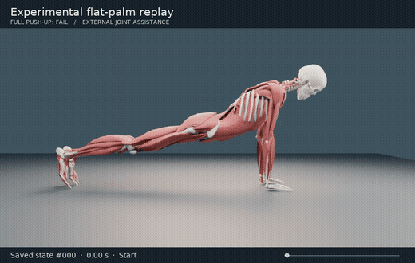
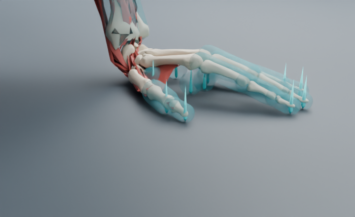
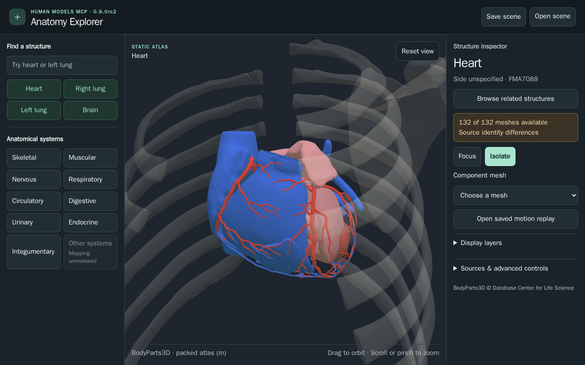

# Human Models MCP

A local, programmable anatomy atlas and MuJoCo research environment. Inspect the
model signals and contact evidence behind each saved frame in a browser, over
MCP or in Blender.

**0.9.1rc1 Research Preview candidate** · Linux x86-64 · [MCP](docs/MCP_API.md) ·
[Blender](docs/RENDERING.md) · [Asset licenses](notices/THIRD_PARTY.md)

## Experimental flat-palm replay

The preview uses `pushup_flat_palm` with articulated fingers, distributed
frictional contacts and external joint assistance. Its palm-and-digit
distribution criterion passed. The full push-up gate, four supports, stationary
supports and numerical bounds **failed**.

[](docs/demo/whole-body.mp4)

[Demo evidence and credits](docs/demo/README.md) ·
[Contact measurements and limitations](docs/CONTACT_MODEL_AND_LIMITATIONS.md)

## Windows Quick Start

Extract the Windows x64 ZIP and open `Start.cmd`. Confirm the Core installation,
then select **Run first experiment**. The Windows release candidate is under
acceptance testing. [Windows setup and known limits](README-WINDOWS.md)

## Linux Quick Start

Use Linux x86-64, Docker Engine with Compose, GNU Make and Python 3.12 with
`venv`. Run from the root of the full public source tree.

```sh
make build
python3 scripts/experiment.py --scenario pushup_flat_palm --output outputs/my-flat-palm
```

The command writes model outputs, named acceptance checks and the saved-state
clock. [Setup and offline use](docs/GETTING_STARTED.md) ·
[Query MCP, open the browser and export Blender](docs/PREVIEW_WORKFLOW.md)

## Hands at the bottom of the replay

| Right hand | Left hand |
| --- | --- |
| [](docs/demo/hand-right.png) | [](docs/demo/hand-left.png) |

Blender close-ups at saved state 55 (2.20 s). The overlays show contact
proxies and reaction directions. The stationary-support check failed.
[Contact evidence and display exclusions](docs/demo/README.md#visible-geometry-and-contact)

## Anatomy Explorer

[](docs/demo/explorer-heart.png)

**STATIC ATLAS** · Heart (FMA7088) selected in the browser. The Structure
inspector lists available meshes and flags source identity differences.
[Install Anatomy Explorer](docs/V09_ANATOMY_LAB.md#install-the-atlas) ·
[Query the `anatomy_lab` MCP tool](docs/V09_ANATOMY_LAB.md#query-anatomy_lab)

## Explore the evidence

| View | What you can inspect |
| --- | --- |
| [Matched browser and Blender phases](docs/demo/matched-phases.png) | 111 saved states over 4.4 s. The floor and saved positions are preserved. |
| [Contact inspector](docs/demo/desktop-contact.png) | Native contact proxies, per-state receipts and explicit failed checks. |
| [Muscle inspector](docs/demo/desktop-pectoralis.png) and [signal plots](docs/demo/muscle-signals.png) | 700 native actuators, partial anatomy associations and an exact state clock. |
| [Static atlas layers](docs/demo/static-atlas.png) | BodyParts3D layers for skin, skeleton, musculature and organs. |

Human experimental validation remains `NOT_VALIDATED`. Native activation and
force describe model transmission paths. Static atlas geometry and illustrative
moving surfaces have their own provenance and scope.

[Capability matrix](docs/RELEASE_090.md) · [Scientific scope](docs/SCIENTIFIC_SCOPE.md) ·
[Publication guide](docs/PUBLICATION.md) · [Citation](CITATION.cff)
