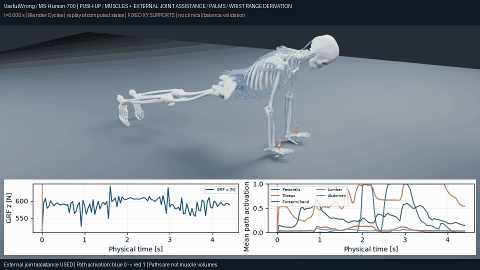

# Human Models MCP

**by UsefulWrong · 0.7.0 · Public Research Preview**

AI agents can run inspectable musculoskeletal simulations and retrieve numeric
results, model provenance and rendered evidence.

[](docs/demo/animation.mp4)

**Computed motion, with external joint assistance.** This `pushup_palms` run uses
700 muscle actuators, fixed horizontal supports and a declared wrist-range
derivative. Colors show model activation; lines are transmission paths, not
muscle volumes. No human or clinical validation is claimed.
[MP4](docs/demo/animation.mp4) · [Data and scientific passport](docs/demo/README.md)

**[Run →](docs/GETTING_STARTED.md)** · **[Inspect the science →](docs/SCIENTIFIC_SCOPE.md)**

`MCP / CLI → MuJoCo → saved states & model data → Blender → evidence`

## Quick start

Linux x86-64, Docker Engine with Compose, GNU Make and Python with venv support.
The first line maps container ownership to your user. The build downloads
pinned dependencies, models and Blender; allow several
GB of disk space. Scientific execution uses Python 3.12 in Docker. No NVIDIA
GPU, desktop or host Blender installation is needed.

```sh
export HMM_UID="$(id -u)" HMM_GID="$(id -g)"
make render-build
make render-preview
```

Open the printed local `index.html`: five CPU-rendered states, MP4/GIF, numeric
data and provenance. This is a quick preview; the animation above has more
frames. [Installation, resources and troubleshooting](docs/GETTING_STARTED.md).

## Use with an agent or without AI

Generate an MCP stdio connector for this checkout:

```sh
python3 scripts/print_client_config.py
```

Use the printed command and arguments in your MCP client's configuration.
The [SDK client and tool guide](docs/MCP_API.md) includes discovery, experiment
calls, chunked downloads and structured refusals. MCP is a local, single-user
tool; the HTTP transport is container-loopback only.

Run an experiment directly, without an agent or Blender:

```sh
export HMM_UID="$(id -u)" HMM_GID="$(id -g)"
make build
python3 scripts/experiment.py --scenario pushup --output outputs/my-pushup
```

Choose a new output directory for each run. The command prints a result page
and exports checked CSV/JSON/NPZ artifacts.

## Scientific scope

| Scenario | Control and interpretation |
| --- | --- |
| `pushup` 1.0.0 | Native 700-muscle recruitment, no external joint/body forces in muscle mode; synthetic reference, added damping and contact proxies. Separate numerical and exercise gates. |
| `pushup_palms` 1.5.0 | Full palm cycle shown above; muscle recruitment **plus external residual joint assistance**, ideal sticking supports and two modified wrist bounds. |
| `pushup_knuckles` 1.2.0 | Neutral fists and tucked elbows; muscle recruitment **plus external residual joint assistance**, fixed finger posture. Different stance and wrist envelope from palms. |

These configurations are not a controlled human comparison. Activation is not
EMG; joint ranges are model settings. Ligaments, deformable tissue, injury risk
and patient-specific predictions are unavailable. The included wrist benchmark
compares a narrow geometric quantity with published cadaver aggregate data;
it does not validate dynamic push-ups.

[Reproduce an experiment](docs/REPRODUCIBILITY.md) ·
[Model sources](docs/MODELS.md) · [Rendering](docs/RENDERING.md) ·
[Security](SECURITY.md) · [Contribute](CONTRIBUTING.md) ·
[Release notes](CHANGELOG.md) · [RC evidence](reports/PUBLIC_RELEASE_AUDIT.md)

Wrapper code: [MIT](LICENSE). Model and MuJoCo: Apache-2.0. Optional Blender:
GPL-3.0-or-later. These are separate licenses; see the
[component and demo notices](notices/THIRD_PARTY.md) and [citation](CITATION.cff).
