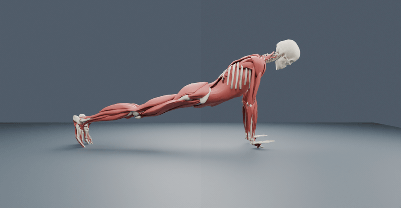
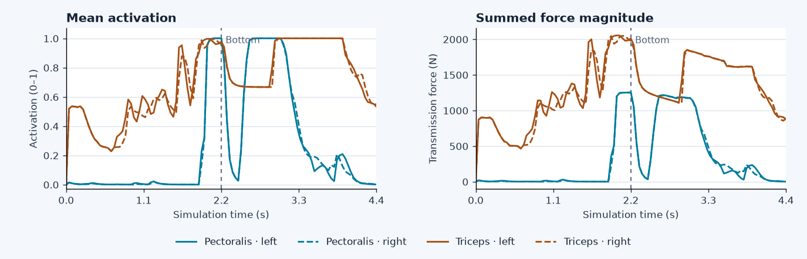

# Human Models MCP

**Watch a full-body simulation and inspect the muscle signals behind every frame.**

v0.9.0rc1 Research Preview · MuJoCo + MS-Human-700 · [MIT code](LICENSE) · [Asset licenses](notices/THIRD_PARTY.md)

## Whole-body assisted push-up

[](docs/demo/v09/whole-body.mp4)

The browser and Blender replay the same **111 saved states over 4.4 seconds**.
Anatomy Explorer shows **290 illustrative moving muscle surfaces** and lets you
pause, seek and inspect a muscle by side, FMA concept or source mesh.

[Play the MP4](docs/demo/v09/whole-body.mp4) ·
[Open the pectoralis inspector capture](docs/demo/v09/pectoralis-inspector.png) ·
[See the demo evidence and credits](docs/demo/v09/README.md)

### Muscle signals at the same time points

[](docs/demo/v09/muscle-signals.png)

The MCP and browser expose eight signal fields for **all 700 native actuators**.
The plot shows model activation and transmission-force magnitude for the left
and right pectoralis and triceps. The dashed line marks the bottom at **2.2 s**.
[Download the plotted data](docs/demo/v09/muscle-signals.csv)

The crosswalk has **76 reviewed correspondences**. A geometry-only surface
has no linked signal. The push-up uses recorded joint assistance
(`muscle_driven=NOT_ACHIEVED`, `external_control=USED`).
Surface motion is illustrative, activation is a model output, and human
experimental validation remains `NOT_VALIDATED`.
[Release notes and capability matrix](docs/RELEASE_090.md)

## Start here

Use Python 3.12 on Linux x86-64 with Docker Engine, Compose and Make:

```sh
make build
make client
```

The example opens a real MCP stdio session and runs the default elbow sweep.
[Install the optional Anatomy Explorer and Muscle Intelligence overlay](docs/V09_ANATOMY_LAB.md).

## Compute and render the push-up

Linux x86-64, Docker Engine + Compose, GNU Make and Python 3.12 with `venv`.
The first build downloads the pinned model and renderer. Start with the
scientific and muscle views on CPU. [Setup and troubleshooting](docs/GETTING_STARTED.md)

```sh
export HMM_UID="$(id -u)" HMM_GID="$(id -g)"
make render-build
make render-start
python3 scripts/visualize.py research --scenario pushup_palms \
  --recipe pushup_scientific --recipe pushup_muscle_paths \
  --recipe pushup_cinematic --idempotency-key palms-first
```

Use the returned run UUID to inspect the muscle-only criterion and the job
UUID to check progress or download completed media.

```sh
python3 scripts/visualize.py evidence RUN_UUID --claim-id gate:muscle_driven
python3 scripts/visualize.py status JOB_UUID
python3 scripts/visualize.py download JOB_UUID --output outputs/palms-scientific
```

After [provisioning the optional licensed anatomy](docs/V08_WORKFLOW.md#install-and-provision),
replay the same run with the regional atlas.

```sh
python3 scripts/visualize.py render --run-id RUN_UUID --recipe pushup_rectus \
  --frames 61 --fps 14 --device cpu --wait --output outputs/palms-anatomy
```

[Reproduce the historical v0.8 four-view demo](docs/V08_WORKFLOW.md)

## Connect an agent

```sh
python3 scripts/print_client_config.py
make client
```

Copy the printed stdio configuration into the MCP client. Discover scenarios
and recipes with `list_scenarios` and `list_render_profiles`. Then call
`run_scenario` with a `visualization` object to calculate once and queue named
views. The reply carries the run UUID, acceptance records and job UUIDs.
`get_result` provides claim-level evidence. Blender artifacts are retrieved
in checksum-verified chunks. [MCP schemas and Python example](docs/V08_WORKFLOW.md#mcp-and-python)

## Methods and scope

[Scientific scope](docs/SCIENTIFIC_SCOPE.md) ·
[Rendering and reproducibility](docs/RENDERING.md) ·
[Anatomical mapping and Fit3D](docs/V08_ANATOMICAL_EVIDENCE.md) ·
[Experimental moving atlas](docs/V08_MOVING_ATLAS.md) ·
[v0.8 release notes](docs/RELEASE_080.md) ·
[Historical public demo](docs/demo/README.md)

Built by [UsefulWrong](https://github.com/usefulwrong). See [citation](CITATION.cff) and [contributing](CONTRIBUTING.md).
