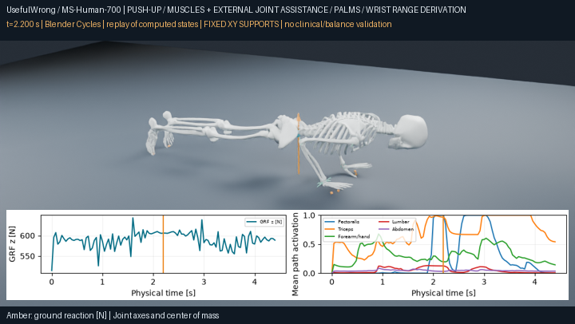
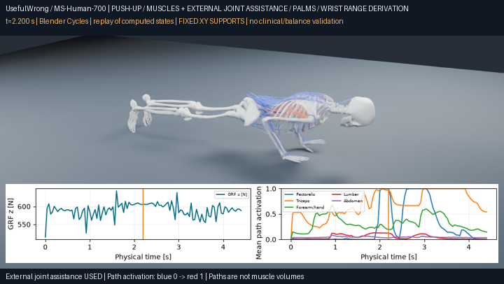
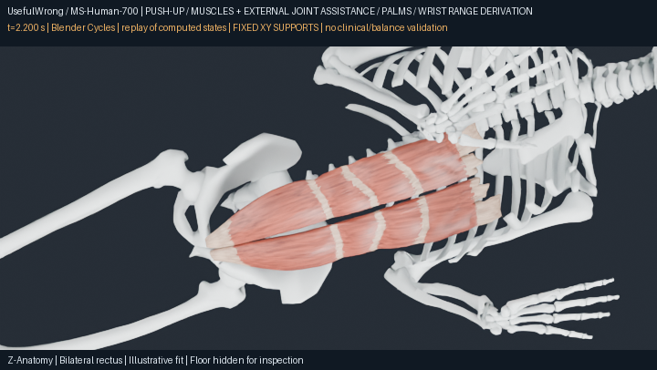
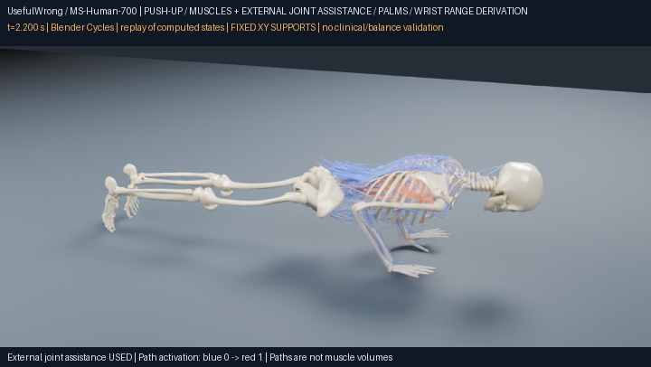
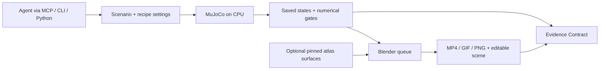

# Human Models MCP

**Run a musculoskeletal experiment, see the movement in Blender, and inspect the evidence behind every view.**

UsefulWrong · v0.8.0 Research Preview · MuJoCo + MS-Human-700 · [MIT code](LICENSE) · [Asset licenses](notices/THIRD_PARTY.md)

## One computed palm push-up, four views

| Simulation | Muscle Activity |
| --- | --- |
| [](docs/demo/workflow/simulation.mp4) | [](docs/demo/workflow/muscle.mp4) |
| Joint axes, centre of mass and saved ground reaction in newtons. | Native musculotendon paths and recorded actuator activation. [Activity and force plots](docs/demo/workflow/plot.png) |
| **Anatomy** | **Cinematic** |
| [](docs/demo/workflow/anatomy.mp4) | [](docs/demo/workflow/cinematic.mp4) |
| Z-Anatomy rectus abdominis, bilateral two-landmark fit. Geometry and frame transfer checked. Registration remains illustrative. | The same states with studio materials, light and camera in Blender Cycles. |

### Evidence

| Observation | Result for this run |
| --- | --- |
| CPU MuJoCo calculation | **Completed** using pinned MS-Human-700 and a synthetic motion reference |
| Exercise and declared numerical criteria | **PASS** for the scenario's named gates with fixed horizontal support guides |
| Muscle-only control | **NOT_ACHIEVED**. Residual joint assistance was used. |
| Regional atlas | **Illustrative**. Surface transfer checked against the fitted geometry. Attachment and crossing review remains open. |
| Human biomechanics | **NOT_VALIDATED**. No paired motion capture, force plate or EMG measurements. Tissue mechanics and exercise safety are unsupported. |

[Animated preview](docs/demo/workflow/muscle.gif) · [Matched start / bottom / return](docs/demo/workflow/phases.png) · [Experiment passport and exact sources](docs/demo/workflow/README.md) · [Machine-readable evidence](docs/demo/workflow/evidence.json)

Human Models MCP lets an AI agent run a named musculoskeletal experiment
and inspect model-specific measurements of movement, force and activation.
The agent can trace an answer to a saved result, its acceptance criteria
and the exact states used for visualization.



## Run it

Linux x86-64, Docker Engine + Compose, GNU Make and Python 3.12 or 3.13 with `venv`.
The first build downloads the pinned model and renderer. Start with the
scientific and muscle views on CPU. [Setup and troubleshooting](docs/GETTING_STARTED.md)

```sh
export HMM_UID="$(id -u)" HMM_GID="$(id -g)"
make render-build
make render-start
python3 scripts/visualize.py research --scenario pushup_palms \
  --recipe pushup_scientific --recipe pushup_muscle_paths \
  --recipe pushup_cinematic --idempotency-key palms-first
```

Use the returned run UUID to inspect the muscle-only criterion and the job
UUID to check progress or download completed media.

```sh
python3 scripts/visualize.py evidence RUN_UUID --claim-id gate:muscle_driven
python3 scripts/visualize.py status JOB_UUID
python3 scripts/visualize.py download JOB_UUID --output outputs/palms-scientific
```

After [provisioning the optional licensed anatomy](docs/V08_WORKFLOW.md#install-and-provision),
replay the same run with the regional atlas.

```sh
python3 scripts/visualize.py render --run-id RUN_UUID --recipe pushup_rectus \
  --frames 61 --fps 14 --device cpu --wait --output outputs/palms-anatomy
```

[Recreate the exact four-view demo, including settings for each recipe](docs/V08_WORKFLOW.md)

## Connect an agent

```sh
python3 scripts/print_client_config.py
make client
```

Copy the printed stdio configuration into the MCP client. Discover scenarios
and recipes with `list_scenarios` and `list_render_profiles`. Then call
`run_scenario` with a `visualization` object to calculate once and queue named
views. The reply carries the run UUID, acceptance records and job UUIDs.
`get_result` provides claim-level evidence. Blender artifacts are retrieved
in checksum-verified chunks. [MCP schemas and Python example](docs/V08_WORKFLOW.md#mcp-and-python)

## Methods and scope

[Scientific scope](docs/SCIENTIFIC_SCOPE.md) ·
[Rendering and reproducibility](docs/RENDERING.md) ·
[Anatomical mapping and Fit3D](docs/V08_ANATOMICAL_EVIDENCE.md) ·
[Experimental moving atlas](docs/V08_MOVING_ATLAS.md) ·
[v0.8 release notes](docs/RELEASE_080.md) ·
[Historical public demo](docs/demo/README.md)

Built by [UsefulWrong](https://github.com/usefulwrong). See [citation](CITATION.cff) and [contributing](CONTRIBUTING.md).
