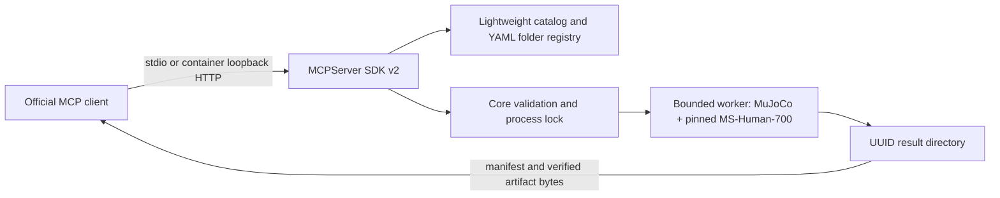

# Architecture

One Python package, two pinned variants of one source model and trusted bounded
numerical backends. There are no remote model services or LLM calls in science
or rendering runtime. Historical sections below record incremental extensions.

`catalog.py` reads the model lock and installed distribution metadata; discovery
does not import MuJoCo or NumPy. `registry.py` uses safe YAML and strict Pydantic
schemas. Each immediate scenario folder supplies manifest, scope, references
and executable validation conditions. Both YAML files have strict schemas and
16 KiB limits. Invalid folders are isolated in `quarantined`.
Trusted numerical backends are explicitly enumerated in the registry; adding a different solver requires
reviewed adapter code rather than a YAML command.

`core.py` serializes scientific operations across server processes using
`flock`. A busy server returns `busy` without building a queue. The worker
executes a fixed Python module without a shell, verifies every model file, then
loads the pinned XML. It has a 90 s wall limit, 45/50 s soft/hard CPU limits,
2 MiB file limit and 128 file descriptors. Compose limits total container
resources to two CPU cores, 3 GiB RAM and 128 processes. The root filesystem is
read-only, `/tmp` is a 512 MiB tmpfs, and runtime networking is disabled.

`joint_sweep` calls `mj_forward` at each prescribed pose and at ±1e-6 rad
probes, reads the sparse actuator transmission Jacobian, compares it with a
central difference, and records the last identical pose for rendering. This
backend never calls `mj_step`. Fixed-coordinate mode retains all other `qpos`
at upstream init. `coupled_knee` updates eight source-dependent coordinates,
checks polynomial extrema over the entire interval, and verifies equality
residuals and an independently solved constraint-Jacobian tangent.
An inconsistent derivative fails the run rather than returning a plausible proxy.

`activation_forward` resets activation/velocity/control, sets one excitation and
integrates 1–25 real `mj_step` calls. It records state-aligned time, activation,
signed actuator force and path length, with no floor or posture controller.
Nonfinite state, any engine warning or activation bound failure fails the run.
The initial conditions, integrator and actual step count/time are provenance.
Both backends render their actual final state, with method/time/pose metadata.

`loaded_elbow` derives the same source model with a named soft weld anchored
at the initial pelvis origin; fixture parameters and timestep are recorded.
It integrates 25–200 steps with one muscle excitation and one prescribed joint
torque. Saved `mjSTATE_INTEGRATION` vectors include controls, applied forces and
solver warmstart. `visualization.py` restores these states with `mj_setState`
and calls `mj_forward` without integration. A fixed camera renders 21 raw PNGs;
plots and GIF use the same CSV and state times. Frame/state/CSV/derived-export
hashes are linked. The exact source plus derivation recipe is authoritative;
the diagnostic MjSpec XML export may round floats. An independent E2E rebuilds
the recipe, restarts three saved states, sums transmission forces and reproduces
the final raw pixels. Matplotlib is an isolated plotting dependency, not physics.

Normalized validation rules are part of the scenario/request hashes, saved as
`validation.json`, and their SHA-256 and executed checks enter the run manifest.
Default sign rules apply only when muscle/joint/range/sample defaults match.
Repeat-run tolerance is consumed by E2E; a single run never falsely records a
passed independent-repeat check.

`sources.py` builds an in-memory SQLite FTS5 index on demand from the pinned
manual, primary-model muscle and joint identifiers and validated local scenario metadata.
Each result carries revision/hash/license and distinguishes upstream identifiers
from wrapper descriptions. It performs no network calls or generative retrieval.

Results use UUIDs and atomic manifest replacement. A supplied idempotency key
returns its persisted manifest, including failures; changing the request under
the same key is rejected. Omit the key for an independent repeat run. Keys are
stored only as SHA-256. The store refuses new runs at 200 manifests or below
128 MiB free. There is no automatic deletion or quota reset. Linux parent-death
signals kill a worker if its executor dies (including the startup race).
Worker exit/timeout becomes a persisted failure. `get_result` and the next run
recover abandoned `running` records only while owning the store lock, mark them
`failed`/`interrupted`/`unvalidated`, and retain partial files. A live lock owner
prevents recovery. Recovery is on access, not a background scheduler.

E2E engine/client runs have separate persistent stores under reports/ for each
test session, so repeated regressions do not consume the production 200-run
budget. `e2e.json` and `fresh-clients-store.json` record their locations. Host
clients exercise the same documented Docker command with an operator-only
`HMM_RESULTS_DIR` volume override; MCP callers cannot change storage paths.

`get_result` returns status/provenance/metrics; `get_artifact` accepts a UUID
and a manifest-listed filename, verifies SHA-256, and returns UTF-8 or base64.
No user paths are accepted. Scientific failures, unavailable engines, unsupported
quantities and invalid inputs have distinct statuses. A requested rendering
failure makes the overall run `failed`; retained numeric outputs have an explicit
`numeric_status: computed`. A render-free request can finish `computed` normally.

The stable MCP boundary is the catalog/capabilities, folder manifest, bounded
worker request, result manifest and artifact-bytes contract. Adding OpenSim or
another engine requires a trusted dispatch branch, strict model/engine-specific
parameter schema, evidence card, unit metadata and a real E2E; a new scenario
using an existing backend needs only its folder. Anatomy lookup adapters would
return attributed reference objects, not computed physics. Physiology needs its
own equations, initial conditions and model license. No unused abstract engine
framework or dynamically imported user plugin is shipped.

HTTP binds only `127.0.0.1:8765`, rejects all browser Origin headers and accepts
only the explicit loopback Host values. It is not published by Compose; clients
must share its network namespace. Host agents use stdio through Docker `-T`.
There is no remote multi-user HTTP deployment or authentication service.

The wheel contains Python modules. A runtime project directory with its model
lock, verified assets, scenarios and requirements lock is required; set
`HUMAN_MODELS_HOME` when running outside that directory. The source distribution
contains the supporting project files but excludes downloaded model assets.

`make package` retains versioned wheel/sdist plus an exact Docker image archive,
notices, hash manifest and an immutable-image Compose file. It verifies all
bytes, reloads its own project image and launches new offline clients with new
result directories. Bundle verification uses stdlib only and does not mutate Git.

## v0.4 additions

Five trusted dispatches now share the same MCP request/result/artifact tools:
joint_sweep, activation_forward, loaded_elbow, elbow_tracking and wrist_benchmark.
`PARAMETER_TYPES` is the single schema map used for input validation and exposed
parameter_schema. New folders using a trusted backend still need no core edits.

The wrist adapter independently verifies the pinned article/CSV, derives a
mesh-based functional frame, solves neutral and transforms length derivatives.
Published data are never used to fit model geometry. Its reference files,
comparison protocol, numeric rows and plots are artifacts of the same run.
The tracking mode reuses the full-model loaded integration/state/render pipeline,
with a bounded actual feedback law and distinct controller provenance/work
accounting. The original loaded defaults keep identical numeric results.

The lightweight catalog exposes known unsupported quantities, scoped evidence
and execution-integrity terminology. FTS5 indexes exact IDs, a pinned external
experimental source and explicitly labeled wrapper scope documents. Shared
warning boilerplate was removed from every identifier's search text after the
real agent found generic queries dominated by duplicate disclaimers.

`examples/mcp-client/artifacts.py` is client-side export: it transfers all bytes
through MCP into a new named directory, verifies file sizes/hashes and writes
an escaped offline index.html. No host path is added to the server API.
The generic call_tool bridge lets an independent LLM choose requests freely;
it records receipts and can decode an image into a file for actual visual
inspection. Its scenario-dir option is a trusted, project-local, read-only Docker
test mount; it cannot be supplied through MCP tool parameters.

## v0.5 contact extension

The same ten MCP tools serve two fixed model IDs. catalog.MODEL_FILES maps
primary and locomotion to reviewed pinned entry files; callers cannot pass an
arbitrary XML path. describe_scenario.model selects the card. Old backends remain
primary-only; the two contact backends require locomotion and strict schemas.
Discovery still performs no scientific import. A worker verifies the full asset
lock, then uses the selected model. No user-defined Python/controller loading.

adapters/contact.py owns initialization, native contact decoding, external wrench,
kinematic momentum checks and numerical files. contact_visualization.py restores
those integration states and draws native geometry plus data overlays. It does
not integrate or add collision geometry. Chunked contact JSON and trajectory
metadata preserve force frames, units, coordinate/actuator/body orders and finite
partial files. The result contract adds outputs.contacts and a scoped
scientific.numerical_status without changing tool names or execution statuses.

The first-experiment launcher uses the local official-SDK client after make build.
In an offline bundle it runs the packaged client inside the bounded image and
mounts only a chosen project-local export parent. A stdlib connector generator
resolves the current bundle location; no developer's static codex.toml is shipped.
Package checks rename the completed bundle before testing the connector/clients.

## 0.6 separate visualization runtime

rendering.py adds four typed MCP tools and a Python API without heavy imports.
Its local durable queue is immutable input snapshots plus atomic JSON records
and one flock-owned worker. render_worker.py runs a fixed headless Blender
entrypoint in a separate prestarted container, not Docker from within MCP.
scene_export.py restores integration states, performs mj_forward, exports animated
USD and native double-precision coordinate references. blender_scene.py imports,
verifies/bakes source geometry and renders bounded Cycles frames. A downloaded
.blend is standalone. visualize.py and scripts/visualize.py expose the same job
operations without an agent. Science results are mounted read-only by Blender;
failures remain in the render job. See [runtime and trust contracts](RENDERING.md).
