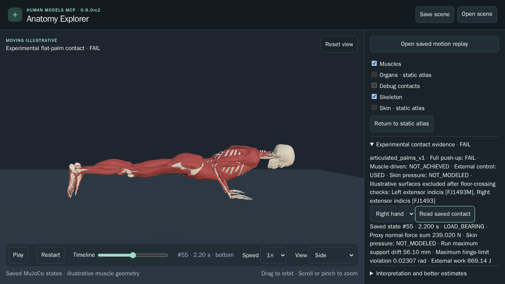
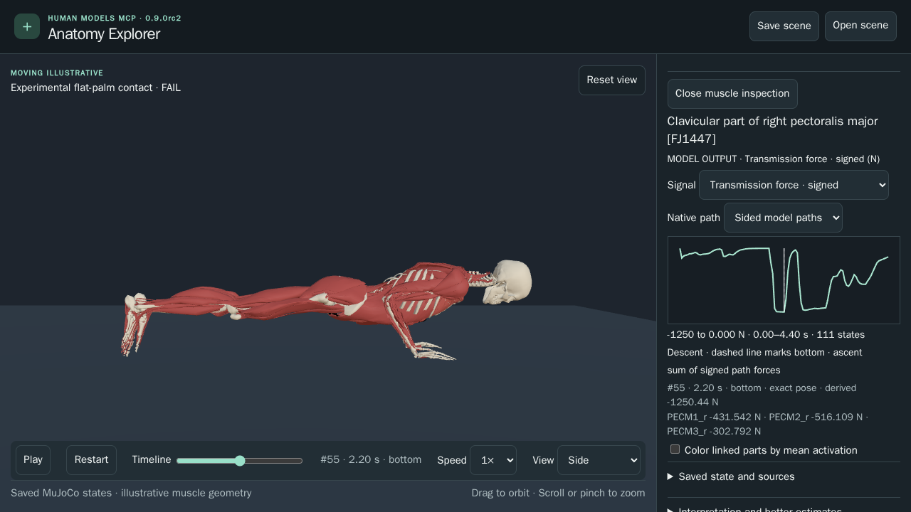

# Run, inspect and export the articulated flat-palm replay

From the full source tree after the [Linux quick start](GETTING_STARTED.md),
use a fresh output directory for each calculation.

```sh
python3 scripts/experiment.py --scenario pushup_flat_palm --output outputs/my-flat-palm
python3 scripts/print_client_config.py
```

Read `run_id` from the generated `manifest.json`. Run these requests through
the core stdio connector, or send their JSON arguments from an MCP client.

```sh
run_id=$(python3 -c 'import json; print(json.load(open("outputs/my-flat-palm/manifest.json"))["run_id"])')
.client-venv/bin/python examples/mcp-client/call_tool.py get_result \
  --arguments "{\"run_id\":\"$run_id\",\"claim_id\":\"gate:full_pushup\"}" \
  --trace-dir outputs/my-flat-palm-requests
.client-venv/bin/python examples/mcp-client/call_tool.py get_contact \
  --arguments "{\"run_id\":\"$run_id\",\"part\":\"hand_r\",\"sample\":55}" \
  --trace-dir outputs/my-flat-palm-requests
```

The preview reports `full_pushup=FAIL`. At frame 55, the contact receipt
gives saved reactions and moments with units and source hashes. Replace
`hand_r` with `hand_l` for the other hand. [Preview contact receipt](demo/contact-frame-055.json)

[](demo/desktop-contact.png)

**Contact inspector** · The experimental replay displays the full-cycle
failure and the selected right-hand contact receipt at frame 55.
[Both hands in Blender](demo/README.md#visible-geometry-and-contact)

For the optional browser, [provision Anatomy Explorer](V09_ANATOMY_LAB.md)
and [build and install the matching MotionScene and crosswalk](V09_ANATOMY_LAB.md#enable-muscle-intelligence-for-a-saved-run).
Then open [the local viewer](http://127.0.0.1:8766/?motion=whole). Open
**Experimental contact evidence** and select frame 55. In **Muscles**, search
for the right pectoralis major and choose the signed transmission force.
Use the [Anatomy Lab MCP connector](V09_ANATOMY_LAB.md#query-anatomy_lab)
with the motion and crosswalk settings from the overlay install. Replace
`RUN_UUID` with the same run ID and call `anatomy_lab` with these arguments.

```json
{
  "request": {
    "operation": "muscle.timeseries",
    "run_id": "RUN_UUID",
    "group_id": "pectoralis_major:right",
    "metric": "force_N",
    "unit": "N"
  }
}
```

[](demo/desktop-pectoralis.png)

**MODEL OUTPUT** · The pectoralis inspector displays native transmission
force from the installed run, with the cursor at frame 55 (2.20 s).
[Signal definitions and comparison plots](demo/README.md#model-signals-at-the-same-states)

To export and reopen the installed replay, use Blender 4.5 from the checkout
root. Run these commands with `HMM_LAB_WHOLE` pointing to the installed
`motion.json` in a writable MotionScene directory.

```sh
clip="$(dirname "$HMM_LAB_WHOLE")"
mkdir -p "$clip/render"
blender -b --disable-autoexec --python-exit-code 1 \
  --python scripts/anatomy_lab/moving/blender.py -- "$clip" build
blender -b "$clip/render/scene.blend" --disable-autoexec --python-exit-code 1 \
  --python scripts/anatomy_lab/moving/blender.py -- "$clip" verify
```

The MotionScene pins `motion.glb`. Its builder also makes `samples.json` and
`coverage.json` for the Blender reopen check. The scene's text block records
the run, scope, exclusions and license terms. The [core CPU Blender preview](GETTING_STARTED.md#first-blender-preview)
uses the same scenario and remains available without optional atlas assets.
