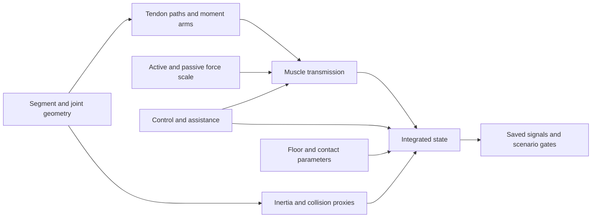

# Reference model parameter inventory

This inventory applies to the pinned MS-Human-700 source and the present CPU MuJoCo push-up adapter. API bounds describe accepted inputs. A calibrated human or material range needs separate evidence.

| Parameter | Unit | Source and available engineering settings | Dependencies and calibration gap |
| --- | --- | --- | --- |
| Muscle strength scale | 1 | `PushupParameters` accepts [0, 1], default 1. The adapter scales both `actuator_gainprm[:,2]` and `actuator_biasprm[:,2]`. The project uses zero as an engineering negative control. | Active and passive transmission force affect recruitment and residual joint control. A physiological range is `NOT_AVAILABLE`. |
| Segment dimensions, mass, COM and inertia | m, kg, m, kg·m² | Pinned model XML and meshes. No anthropometric resize parameter in this scenario. | Inertia, joint frames/ranges, tendon sites, moment arms, collision coverage, IK and controller must remain consistent after any scale change. Supported anthropometric bounds are `NOT_AVAILABLE`. |
| Tendon and muscle properties | m for route/length bounds, s for modeled time constants, N for force scale | Pinned XML, compiled actuator inventory and recorded recipe. Route changes in the articulated hand are model-specific. | Muscle transmission uses route-level force, length and velocity. Independent tendon compliance and patient-specific properties are `NOT_AVAILABLE`. |
| Controller and support | Categorical mode, N·m for bounded hinge assistance | The current `pushup_flat_palm` recipe uses `assisted_muscle` and `frictional_contact`. Residual torques depend on allocation and pose tracking. | Assistance changes the load path. A human neural control calibration is `NOT_AVAILABLE`. |
| Sliding friction | 1 | API [0.05, 1.5]. The current `pushup_flat_palm` recipe specifies 0.8. | Proxy contact cones, integration and support acceptance depend on friction and compliance. Material, skin and population bounds are `NOT_AVAILABLE`. |
| Timestep | s | Adapter accepts 0.0005 or 0.001. | Affects numerical integration and solver-step work. Use for a convergence study, separately from parameter calibration. |

The historical fixed-support comparison runs `pushup_palms` at 1.3 (its default)
and 0.8 (an explicit override) with `fixed_points` in both cases. Each run
reports its own joint-assistance work and acceptance. A physiological sweep
of strength, anthropometry or tendon properties remains `NOT_RUN/NO_SUPPORTED_RANGE`.

Geometry/mass scaling in OpenSim leaves muscle strength to an explicit update. Any future calibrated reference derivative needs measured segment geometry and a separate force calibration, followed by a comparison with independent data. The present generic source is a reference model.

[OpenSim scaling method](https://opensimconfluence.atlassian.net/wiki/spaces/OpenSim/pages/53089158) · [Hicks et al., 2015](https://pmc.ncbi.nlm.nih.gov/articles/PMC4321112/) · [Pinned scenario defaults](../scenarios/pushup_palms/scenario.yaml) · [Experimental contact defaults](../scenarios/pushup_flat_palm/scenario.yaml)
