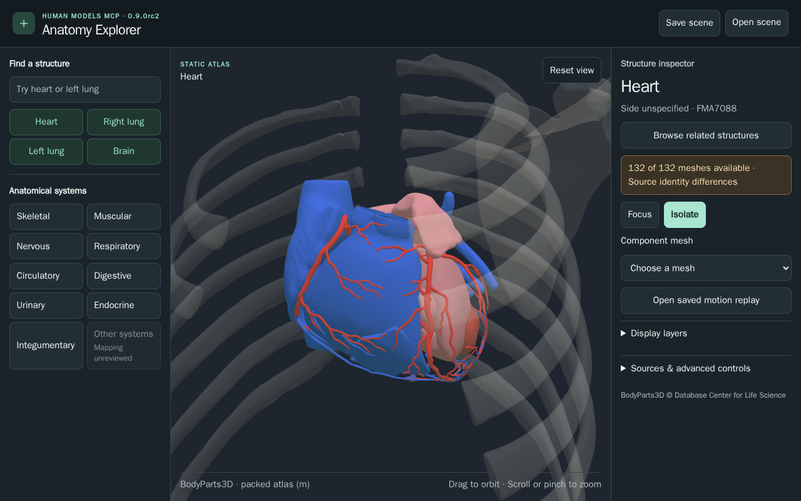

# Anatomy Explorer and the Anatomy Lab MCP tool

Anatomy Lab adds a local BodyParts3D 4.3 viewer, a source-aware FMA registry
and an optional read-only MCP query tool. The source package contains the
installer, viewer and source pins. The installer retrieves the atlas and
builds its derived scene on your machine.

## Install the atlas

After [Linux setup](GETTING_STARTED.md), activate the project's pinned Python
environment from the checkout root. Install Node.js for the viewer's local
bundle preparation. The installer verifies every pinned input and prepares the
viewer. The source cache can be reused in a second installation.

```sh
. .client-venv/bin/activate
python scripts/anatomy_lab/provision.py outputs/anatomy-lab
```

Before installing, review the conditions for the data you plan to use.
BodyParts3D © the Database Center for Life Science. The 4.3 OBJ mirror
carries CC BY-SA 2.1 Japan. The official archive relationship tables carry
CC BY 4.0. The 4.3 and 4.3i metadata and the crosswalk are provisioned
locally, with redistribution rights unconfirmed for those exact files.
The installer displays the source terms and records the URLs, SHA-256 and
retrieval status in `source-receipt.json`. If a source requires an account,
acceptance or another provider step, complete it at the source and place
the matching files in the cache. The installer respects source access
responses. [Pinned mirror terms](https://github.com/olivercase/body_parts_3d_api/blob/fd527e6f4daf732fd814314d9257df5877b844bc/LICENSE) ·
[DBCLS archive license](https://dbarchive.biosciencedbc.jp/en/bodyparts3d/lic.html) ·
[Original BodyParts3D terms](https://lifesciencedb.jp/bp3d/info_en/index.html#License)

To install from files already transferred to an isolated machine, copy the
cache containing `upstream/` and `meshes/`. Use a new destination.

```sh
python scripts/anatomy_lab/provision.py outputs/anatomy-lab \
  --cache /path/to/transferred-source-cache --offline
```

## Open the viewer

```sh
export PYTHONPATH="$PWD/src:$PWD/scripts/anatomy_lab"
export HMM_LAB_CATALOG="$PWD/outputs/anatomy-lab/catalog.json"
export HMM_LAB_SITE="$PWD/outputs/anatomy-lab/site"
python -m lab_web
```

Open `http://127.0.0.1:8766/`. Use `--lan "$LAN_ADDRESS_WITH_PREFIX"`
to bind a private IPv4 interface and allow clients on its specified subnet.
The viewer opens an anterior surface preview from the installed atlas.
Choose a featured organ, search by name or by exact FMA/FJ identifier,
or browse an anatomical system. System shortcuts are curated entry points.
The source hierarchy uses the Registry's direct Part-of and Is-a edges
and shows both parents and children. Source coverage varies by branch.

[](demo/explorer-heart.png)

**STATIC ATLAS** · Choose **Heart** to inspect FMA7088 and its source mesh
coverage. The Structure inspector flags conflicting source identities.
[Screenshot provenance and credits](demo/README.md#anatomy-explorer)

Click or tap a visible object for its exact FJ and recorded concept
candidates. Check the patient side and the source of each candidate.
A primary mesh identity and a composite membership are distinct claims.
The inspector reports recorded and renderable counts. Advanced controls
retain the membership selector (4.3, 4.3i or their explicit union on the
4.3 OBJ inventory), atlas presets and saved motion. **Isolate** hides
nearby context and **Restore context** brings it back. In the atlas
overview, **Display layers** loads any installed layer on demand. Skin
becomes translucent when internal layers are visible. In a selected
scene the controls filter its geometry and context. **Open atlas overview**
returns to the full layer list. The context opacity slider changes the
translucency of the surrounding anatomy.

**Save scene** exports the composite as `hmm.anatomy.scene/1`. It pins the
catalog, display index and full resolved selection by SHA-256. **Open
scene** re-resolves that selection before loading any required display
packs. Optional `composite_view.hidden_layers` and
`composite_view.context_opacity` record display preferences. Older
documents omit these fields and retain their previous canonical hash.
Direct FJ or preset views use `hmm-viewer-spike/1`. The existing loader
supports that format with the corresponding asset inventory.

To use current viewer sources with an existing composite installation,
stage a separate site. Keep the installed pack manifest and file names
intact. A legacy 17-pack site requires reprovisioning.

```sh
atlas="$HMM_LAB_CATALOG"
installed_site="$(dirname "$atlas")/site"
mkdir -p outputs
site="$(mktemp -d "$PWD/outputs/explorer-site.XXXXXX")"
cp -R scripts/anatomy_lab/site/. "$site/"
cp -a "$installed_site/full" "$site/full"
cp -a "$installed_site/npm/node_modules" "$site/npm/node_modules"
export HMM_LAB_SITE="$site"
python -m lab_web --site "$site"
```

## Query anatomy_lab

Run these commands from the checkout root in a shell with the Python
environment and the three variables from [Open the viewer](#open-the-viewer).
Start a separate shell with the same settings if the viewer is already running.

For an MCP client, use the absolute path to `.client-venv/bin/python` as its
stdio command, with arguments `["-m", "lab_mcp"]`. Pass `PYTHONPATH`,
`HMM_LAB_CATALOG` and `HMM_LAB_SITE` to the server process. After discovery,
call the tool named `anatomy_lab` with an outer `request` field. This
official-SDK example launches the stdio server and searches the local catalog.

```sh
python - <<'PY'
import asyncio
import json
import os
import sys
from mcp import Client, StdioServerParameters

async def main():
    server = StdioServerParameters(
        command=sys.executable, args=["-m", "lab_mcp"], env=dict(os.environ)
    )
    async with Client(server) as client:
        reply = await client.call_tool("anatomy_lab", {
            "request": {"operation": "anatomy.search", "query": "heart", "limit": 5}
        })
        assert not reply.is_error
        assert reply.structured_content["status"] == "ok"
        print(json.dumps(reply.structured_content, indent=2))

asyncio.run(main())
PY
```

The browser's HTTP endpoint accepts the inner request directly while
`lab_web` is running. Use the same request without a server via `lab_cli`.

```sh
request='{"operation":"anatomy.search","query":"heart","limit":5}'
curl --fail-with-body -sS http://127.0.0.1:8766/api/query \
  -H 'Content-Type: application/json' --data "$request"
printf '%s\n' "$request" | python -m lab_cli
```

The result includes the heart concept (FMA7088). Use exact concepts and a
representation to resolve source meshes. For the composite resolver, send:

```json
{
  "operation": "anatomy.resolve",
  "concept": "FMA7088",
  "representation": {
    "dataset": "BodyParts3D",
    "mesh_version": "4.3",
    "membership_version": "4.3+4.3i"
  },
  "limit": 50
}
```

Follow `next_offset` until it is null. Each page carries the same selection
digest, whole-selection counts and the pack receipts for that page.
Pass the same representation and one FMA identifier in `selection` to
`scene.create` or `scene.select`, and validate a saved state with
`scene.export`. `PARTIAL` indicates source identity conflicts, unresolved
identities or missing installed geometry. Source membership predicates
in this result describe the aggregation of FJ objects. Ontology edges
can be queried separately with `anatomy.relationships`.

### Explorer requests

The table lists fields to send along with `operation`. Use the
representation object from the example above whenever a representation
is requested. The browser uses the same typed replies as stdio. Continue
from `next_offset` for further pages.

| Operation | Installed examples | Ambiguous or unavailable example |
| --- | --- | --- |
| `anatomy.search` | `query: "left lung"` finds FMA7310 with patient laterality. `query: "FJ3028"` finds the exact mesh record. | `query: "lung"` can return several concepts. Choose by name, ID and patient side. |
| `anatomy.describe` | `concept: "FMA7088"` for heart. `concept: "FMA50801"` for brain. | `concept: "FMA999999999"` returns `unknown`. |
| `anatomy.resolve` | `concept: "FMA7088"` or `"FMA7309"` with the 4.3+4.3i representation returns pack receipts, counts and paginated visual memberships. | A requested `mesh_version: "4.4"` is rejected at validation. |
| `anatomy.components` | `concept: "FMA7310"` or `"FMA7480"` lists source membership records and their provenance. | Unknown FMA returns `unknown`. |
| `anatomy.identify` | `mesh: "FJ3028"` with the representation exposes multiple candidate concepts and a BP disagreement. `mesh: "FJ6043"` preserves the competing FMA claims. | `mesh: "FJ99999999"` returns `unknown`. |
| `anatomy.relationships` | `concept: "FMA7310", predicate: "part_of", direction: "in", include_labels: true` lists direct child records. `concept: "FMA5022", predicate: "is_a", direction: "in", include_labels: true` lists recorded muscle classes. | Right/left lung parent coverage can be incomplete. An unknown FMA returns `unknown`. |
| `anatomy.coverage` | Inspect the relation counts by source on the standard catalog and, separately, on the optional FMA 3.2.1 catalog. | `authored_43i_inferred_edges` is `NOT_VERIFIED` in both. |
| `scene.create`, `scene.select` | `selection: ["FMA7088"]` or `["FMA50801"]` plus the representation binds a single composite. Supply the previous `scene` for `scene.select`. | Two different FMA IDs with a single composite representation return `invalid_input`. |
| `scene.export` | Export a saved left-lung document, then a saved heart document. The output includes a canonical scene digest. | A stale `atlas_sha256` returns `unsupported`. A mismatched display or selection hash returns `integrity_error`. |

Anatomical edges can carry a DBCLS archive predicate, a historical FMA
assertion or another locally installed source record. They remain
separate from visual composition. The packed viewer uses metres.
The original mesh spatial operations declare their own native frame in
millimetres and abstain outside the reviewed region.

A user-generated motion artifact can be opened with **Open saved motion**.
For MCP motion binding, set `HMM_LAB_MOTION` to a reviewed regional export
whose sibling run store holds the saved source trajectory. The existing
MuJoCo and Blender workflows generate and verify those artifacts.
[Saved-state workflow](PREVIEW_WORKFLOW.md)

Static views represent the indicated source atlas. Region motion is an
engineering registration. Clinical inference and full anatomical movement
validation are outside this scope. Reported 4.3i composition and directly
verified anatomical graph coverage are tracked separately.

## Add historical FMA relationships

The optional UW FMA 3.2.1 OWL-Full archive supplies named asserted
relationships. Download the pinned [archived UW file](https://web.archive.org/web/20160412160129id_/http://sig.biostr.washington.edu/share/downloads/fma/FMA_Release/alt/v3.2.1/owl_file/fma_3.2.1_owl_file.zip)
under [the terms described by the source authors](https://pmc.ncbi.nlm.nih.gov/articles/PMC3944952/).
The graph supplement verifies the archive and relates identifiers already in
the installed atlas.

```sh
python scripts/anatomy_lab/supplement_graph.py \
  outputs/anatomy-lab/catalog.json outputs/anatomy-lab/catalog-fma321.json \
  --fma321 /path/to/fma_3.2.1_owl_file.zip
export HMM_LAB_CATALOG="$PWD/outputs/anatomy-lab/catalog-fma321.json"
```

Start the MCP server or viewer using that catalog. In
`anatomy.relationships` select `source_id: uw_fma_321_archive` to query
only that historical source. The result retains the original OWL
predicate. Authored 4.3i inference coverage remains partial.

## Replay the experimental flat-palm run

The Explorer can open a locally installed `hmm.anatomy.motion/1` produced from the
original saved `pushup_flat_palm` integration states. The builder is
`scripts/anatomy_lab/moving/build.py`. It uses the pinned native model, published
MyoSuite authored weights for matching joints, and the separately licensed
bilateral Z-Anatomy rectus extraction. Build and Blender import use saved
states. Skin and organ groups remain available in the static atlas.
The current replay uses external joint assistance and shows `full_pushup=FAIL`.
[Hands, contact evidence and saved state clock](demo/README.md)

Configure `HMM_LAB_WHOLE` with the administrator-chosen MotionScene JSON path,
`HMM_LAB_WHOLE_SHA` with its SHA-256 and `HMM_LAB_WHOLE_RESULTS` with the directory
of pinned run UUIDs. `HMM_LAB_WHOLE_RENDER_SHA` optionally pins the
`render/receipt.json` beside the GLB. Open `/?motion=whole` on loopback or use
**Open saved motion replay** in the Explorer. The timeline scrubs
exact source indices. Between exact states, Play uses labeled interpolation.
Anatomy materials are constant display colors.

The same typed request envelope works through HTTP `/api/query`, the
`anatomy_lab` stdio MCP tool and `lab_cli.py`. Operations are
`whole.discover`, `whole.open`, `whole.set_view`, `whole.artifact` and
`whole.contact`.
`whole.set_view` round-trips the `hmm.anatomy.motion-view/1` document containing
run, digest, exact frame, visible layers and camera. The existing
`hmm.anatomy.scene/1` remains the static/regional contract. The artifact reply
contains a SHA-256, byte size and verified same-origin route. The browser
checks the GLB digest with Web Crypto on secure origins, including loopback
HTTP. On private LAN HTTP, the viewer uses the digest returned by the server
after it has verified the bytes. Plain HTTP provides no transport encryption
or authentication. Start the server with `--lan ADDRESS/PREFIX` and open
`http://ADDRESS:PORT/?motion=whole` from the same subnet.

## Whole-body muscle inspector

The optional Muscle Intelligence stage adds a paginated browser inventory to
the installed WholeMotion replay. A search result selects an exact native
actuator or a moving surface. The view can preserve isolation, display
opacity, activation overlay, and the source frame. The existing Anatomy Lab
tool accepts the same typed queries over HTTP and official MCP stdio.

Build a new stage with `python3 scripts/muscle_intelligence/stage.py PATH`.
The local launcher expects the pinned atlas assets, saved scientific run and
crosswalk in the paths set by `scripts/muscle_intelligence/local.sh`. The
crosswalk builder and the evidence scripts live in
[`scripts/muscle_intelligence/crosswalk.py`](../scripts/muscle_intelligence/crosswalk.py).
The scientific quantities and acceptance boundaries follow
[Scientific scope](SCIENTIFIC_SCOPE.md).

### Inspect a registration record

The compatible crosswalk revision 3 adds family evidence, segment-specific
review reasons and candidate geometry references to existing native rows.
Installation keeps using the administrator's crosswalk path and SHA-256.
A family hypothesis can cover many model tendons. Candidate concepts and
geometry references do not authorize overlays.

Use `muscle.registration` through the existing `anatomy_lab` request
envelope or HTTP `/api/query`. Pass the `run_id` and `motion_sha256` from
`whole.open`, `mapping_revision_sha256` from `muscle.describe`, and an exact
`state_index`. Choose one selector.

| Selector | Returned evidence |
| --- | --- |
| `actuator_id` | Native route, family evidence, concepts and candidate geometry |
| `display_node` | Asset provenance and accepted linked paths, if any |
| `group_id` | Reviewed sided paths. Use `offset` and `limit` to page. |

An optional `side` filters the result. Stale revisions or unavailable state
indices return integrity errors. The route includes model sites and wraps.
Model site coordinates are in body-local metres. The attachment and
deformation statuses report absence of independent validation. The browser
shows the same route in **Identity and model route**. Use
`muscle.timeseries` for the recorded values. A geometry-only surface has
no signal series.

### Registration Evidence Inspector

The pilot uses the existing whole-body viewer and the optional
Muscle Intelligence stage. Build the receipt with
[`reference_workbench.py`](../scripts/muscle_intelligence/reference_workbench.py).
Supply the local directory from the muscle-registration experiment, the
verified SHA-256 values of its native QA and Crosswalk V3, and the original
run, MotionScene, and catalog paths. Use a fresh output directory.

```sh
export PYTHONPATH="$PWD/src:$PWD/scripts:$PWD/scripts/anatomy_lab:$PWD/scripts/anatomy_lab/moving"
python scripts/muscle_intelligence/reference_workbench.py \
  --base "$baseline" --qa-sha256 "$native_qa_sha" --crosswalk-sha256 "$crosswalk_sha" \
  --run "$saved_run" --clip "$motion_clip" --catalog "$catalog" --output "$out"
python scripts/muscle_intelligence/stage.py "$out/app"
export HMM_LAB_WORK="$out"
export HMM_LAB_MUSCLE_CROSSWALK="$baseline/CROSSWALK_V3.json"
export HMM_LAB_MUSCLE_CROSSWALK_SHA="$crosswalk_sha"
export HMM_LAB_REGISTRATION_EVIDENCE="$out/REGISTRATION_INSPECTION_QA.json"
export HMM_LAB_REGISTRATION_EVIDENCE_SHA="$(cat "$out/registration-evidence.sha256")"
bash scripts/muscle_intelligence/local.sh
```

Select a pilot surface or native actuator while the timeline is paused,
then open **Registration evidence**. Cyan marks the saved MuJoCo route
and sites. Purple marks a sampled BodyParts3D bone in its archived ICP
pose on the corresponding native bone. Yellow and orange marks identify
the axis-extreme training and held-out proxies in the native geometry.
Named landmarks without coordinates are listed for annotation. Textual
origin and insertion descriptions have no 3D location. The external
oblique remains a geometry-only control.

On HTTP or stdio, use the same `muscle.registration` request with
`evidence_frame: "mujoco_world_m"` and, optionally,
`evidence_revision_sha256`. The bounded reply pins the exact saved state.
Model route samples are world metres. Candidate points on the bone are
in the identified source OBJ or target geom-local coordinates as
indicated by their fields. Existing clients can omit the evidence
fields and get the original registration response.

### Record named shoulder landmarks

Select a sided clavicle, scapula or humerus pair, then open **Named landmark
annotation**. The inspector fetches two local triangle meshes by digest.
The source frame is BodyParts3D OBJ in millimetres. The target is the compiled
MuJoCo geom-local mesh in metres, before motion poses are applied. The axes
show native directions at the mesh centre. The displayed archived ICP
matrix maps source OBJ millimetres to geom-local metres. Viewer rotation
does not change the model's side.

Name and place one point per frame. Click again to adjust it. Supply your
reviewer identifier, HTTPS source citation and uncertainty in millimetres.
Choose FIT or HELD_OUT and append the candidate. Editing creates a new
observation and withdraws the old one. Withdrawal and restoration append
decisions without changing recorded points. Export the history as JSON
and keep prior SHA-pinned versions. Reopen the exported log in the same
inspector. The empty labeling template is LANDMARK_AND_CORRESPONDENCE.json.

Run the receipt build above with the additional argument
`--annotations /path/to/landmark-annotations.json` and a fresh output
directory. Re-stage and pin the new receipt to publish the candidates
to the browser and through HTTP or MCP. The CLI validates IDs, sides,
frames, mesh hashes and each barycentric anchor against the exact mesh
triangles, with a 0.05 mm serialization tolerance. This is a geometric
tolerance, independent of operator uncertainty. Active coordinates within
0.05 mm on either surface are duplicates. A candidate fit uses three
or more non-collinear FIT pairs and scores HELD_OUT pairs without using
them in the transform. Browser observations remain operator candidates.
Expert review and independent measurement require separate provenance.

V1 evidence receipts remain readable. Coordinate-bearing v1 logs need
re-annotation against v2 triangle anchors. The v2 receipt adds explicit
source provenance, geometry fit, expert review, attachment footprint and
human physiological validation fields. The server only reads the
locally installed, SHA-pinned receipt. Annotation editing and downloads
take place locally in the browser. The historical candidate footprint
format is accepted separately as v1.

## Enable Muscle Intelligence for a saved run

Build and stage the overlay in fresh directories. Set the paths below to absolute
paths from the same installation. The MotionScene and compiled v3 crosswalk
must have been produced from the same run, atlas and source model.

```sh
run="$PWD/results/RUN_UUID"  # The computed pushup_flat_palm run
atlas="$PWD/outputs/anatomy-lab"
clip="$PWD/outputs/flat-palm-clip"
myo_glb=/path/to/pinned/fullbody_atlas_light.glb
myo_sim=/path/to/pinned/myo-sim
rectus="$PWD/render_jobs/rectus.npz"
export PYTHONPATH="$PWD/src:$PWD/scripts:$PWD/scripts/anatomy_lab:$PWD/scripts/anatomy_lab/moving:$myo_sim"

python scripts/anatomy_lab/moving/build.py --run "$run" \
  --manifest-sha "$(sha256sum "$run/manifest.json" | cut -d' ' -f1)" \
  --myo-glb "$myo_glb" --atlas "$atlas" --rectus "$rectus" --output "$clip" \
  --accept-licenses CC-BY-4.0,CC-BY-SA-4.0,CC-BY-SA-2.1-JP
python scripts/muscle_intelligence/crosswalk.py --run "$run" \
  --catalog "$atlas/catalog.json" --myo "$myo_glb" --myo-sim "$myo_sim" \
  --clip "$clip" --output "$clip/crosswalk-v2.json"
python scripts/muscle_intelligence/registration_crosswalk.py --v2 "$clip/crosswalk-v2.json" \
  --v2-sha256 "$(sha256sum "$clip/crosswalk-v2.json" | cut -d' ' -f1)" \
  --catalog "$atlas/catalog.json" --myo-sim "$myo_sim" \
  --model "$PWD/models/ms_human_700" --output "$clip/crosswalk-v3.json"
```

Use [the pinned moving-atlas sources](MOVING_ATLAS.md) and the
[rectus preparation recipe](ANATOMICAL_EVIDENCE.md#prepare-the-z-anatomy-rectus-input).
When using an exported run directory, install it under the exact UUID in your
chosen results store before starting the viewer.

```sh
motion="$clip/motion.json"
crosswalk="$clip/crosswalk-v3.json"
results="$(dirname "$run")"
app="$PWD/outputs/anatomy-app"

python scripts/muscle_intelligence/stage.py "$app" --assets "$atlas/site"
export PYTHONPATH="$app/lab:$PWD/src"
export HMM_LAB_CATALOG="$atlas/catalog.json" HMM_LAB_SITE="$app/lab/site"
export HMM_LAB_WHOLE="$motion" HMM_LAB_WHOLE_RESULTS="$results"
export HMM_LAB_WHOLE_SHA="$(sha256sum "$motion" | cut -d' ' -f1)"
export HMM_LAB_MUSCLE_CROSSWALK="$crosswalk"
export HMM_LAB_MUSCLE_CROSSWALK_SHA="$(sha256sum "$crosswalk" | cut -d' ' -f1)"
export HMM_LAB_MUSCLE_SELECTION="$app/shared-selection.json"
python -m lab_web
```

Open `http://127.0.0.1:8766/?motion=whole`. Pass these environment settings
to the same [MCP connector](#query-anatomy_lab) to enable saved-motion and
muscle queries. The export tools are
`scripts/anatomy_lab/moving/build.py`,
`scripts/muscle_intelligence/crosswalk.py` and
`scripts/muscle_intelligence/registration_crosswalk.py`. Run each with
`--help` to see its required source inputs. The moving-scene builder
checks the original atlas receipt, the MyoSuite geometry/source tree and
the rectus asset. The core simulation and static atlas can be installed
independently.

Reviewed muscle selections show exact values on the saved state clock.
Geometry-only nodes show source identity and geometry. Signal data for
a native actuator remains queryable even if its anatomy is unmapped.
The optional landmark editor takes a separately pinned evidence receipt.
Its records preserve the distinction between candidate marks and a
completed independent review.

The [scientific quantity receipt](SCIENTIFIC_QUANTITY_CONTRACT.md) records
the exact saved sample, numerical definitions and artifact hashes behind
the inspector and Blender export. The [reference parameter inventory](REFERENCE_MODEL_PARAMETERS.md)
describes the inputs eligible for bounded engineering checks.
