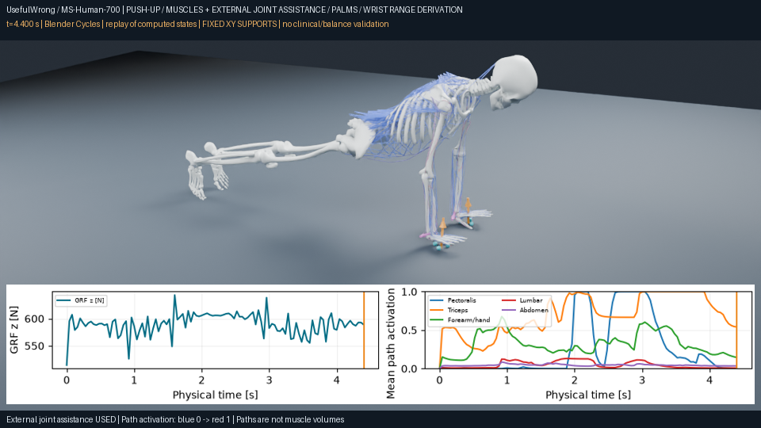
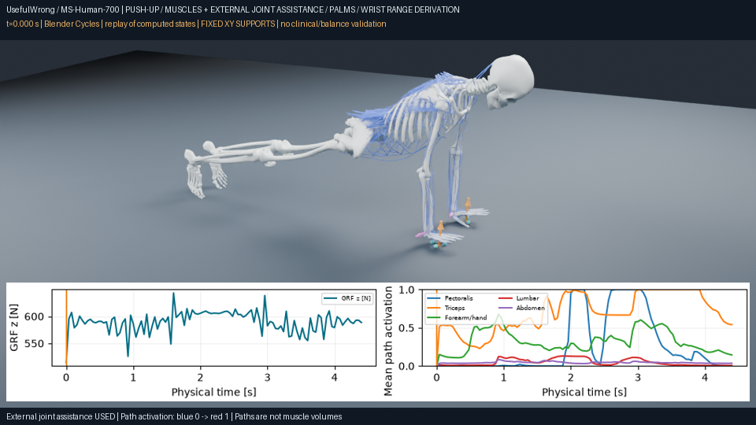
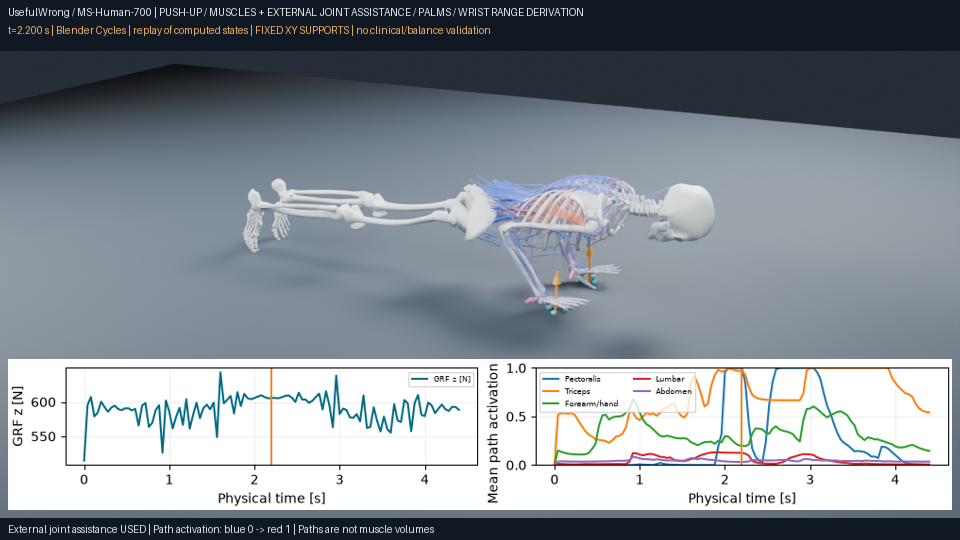

# One computed palm push-up

This is `pushup_palms` **1.5.0**, `palm_technique: chest_full`, computed anew for
this RC with MuJoCo 3.17.0 and rendered from its saved states in Blender 4.5.15
Cycles on **CPU**. It uses muscle recruitment **plus external residual joint
assistance**. It is not the muscle-only `pushup` experiment.

[](animation.mp4)

[MP4](animation.mp4) · [GIF](animation.gif) · [Local viewer](index.html) ·
[Scientific passport](passport.json) · [Run manifest](scientific_manifest.json) ·
[Complete scientific data + licenses](data.zip) · [Summary](summary.json) ·
[Frame clock](frames.json) · [Checksums](assets.json) · [Pectoral traces](plot.png)

GitHub displays images and file links, but does not execute this HTML viewer.
After cloning, open `docs/demo/index.html` locally or serve this directory with
a local static server. No application backend or external assets are needed.
The large editable scene and complete frame archive are prepared separately;
see the [asset inventory](../../reports/PUBLIC_RELEASE_ASSETS.json).

## Exact scientific configuration

| Field | Value |
| --- | --- |
| Wrapper / scenario | 0.7.0 / pushup_palms 1.5.0 |
| Run ID | `9ed1e5d7-40b9-4d4c-96f8-8fcc98e6ac1b` |
| Render job | `b8f93269-91a2-46e3-8e9f-c51bac859da2` |
| Control | `assisted_muscle`; external assistance `USED`; muscle-only `NOT_ACHIEVED` |
| Integration | 0.5 ms, 4.4 s, 8,800 steps, 111 saved states |
| Render | 51 selected saved states, 960 × 540, 8 Cycles samples, 12 FPS |
| Contact | Three spherical pads per palm, toe pads, ideal horizontal sticking guides |
| Wrist derivative | Only `flexion_r/l` lower bounds −0.6 → −0.930016 rad; geometric extension envelope checked every step |
| Model source | Menagerie `98a70c569c4c1b6da467a20012f766ee1f8dc521` |

The movie's 4.25 s presentation clock differs from the 4.4 s physical interval;
each caption and `frames.json` reports the true source time. GIF delays are
quantized separately. Frames are sampled from computed states, without new
physical interpolation. The reference is synthetic, not motion capture.

Measured chest excursion: **27.865 cm**; maximum
horizontal support-point displacement: **0.0946 mm**.
External generalized joint work: **578.014 J**.
These are model results with numerical acceptance, not measurements from a
person. See the complete acceptance and thresholds in the unmodified summary.

| Start (0 s) | Bottom (2.2 s) | Return (4.4 s) |
| --- | --- | --- |
|  |  |  |

## Recompute and rerender

From a fresh source checkout:

```sh
export HMM_UID="$(id -u)" HMM_GID="$(id -g)"
make render-build
make render-start
.client-venv/bin/python examples/mcp-client/render_client.py --scenario pushup_palms --profile scientific --layers bones muscle_paths hand_contacts --frames 51 --fps 12 --width 960 --height 540 --samples 8 --device cpu --timeout 900 --output outputs/my-public-demo
```

Choose a new output path. The client computes a new scientific run, verifies
idempotency, polls Blender and downloads every artifact through checked MCP
chunks. Compare decoded states/CSV with `source.zip` inside `data.zip`; run IDs,
timestamps and whole manifests will differ. Numerical repeat tolerance is
1e-10 in each state component's recorded unit on the tested stack; this is not
a cross-platform pixel/byte identity or human-accuracy promise.

All 700 actuator traces and sparse transmission rows are included. Displayed
418 upper-body routes use actual activation; tube size is presentation.
Pectoral data use the six named bilateral PECM1–3 paths. The graph is model
activation, not normalized EMG. Fingers are rigid, scapular motion is coupled,
floor/skin contacts are proxies, and discrete ligaments are absent. The wrist
derivative is literature-informed, not clinically or individually calibrated.
[Scientific limits](../SCIENTIFIC_SCOPE.md) · [Hand methods](../HAND_DETAIL.md).

## Provenance and rights

The [asset manifest](assets.json) checks every public file. `data.zip` retains
the exact original scientific archive plus package/model locks, MIT wrapper
license and separate component notices. Original model geometry/derivatives
retain Apache-2.0 attribution. No Blender binary, external human photograph,
patient data or generated anatomy artwork is included. See
[third-party notices](../../notices/THIRD_PARTY.md).
