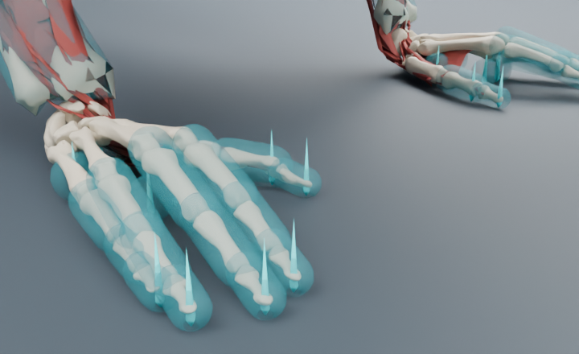

# Experimental flat-palm Research Preview

The current browser and Blender replay use `pushup_flat_palm` 1.0.0,
run `23945f13-419c-4ce4-b12d-c08458cd9ad2`. It has 111 saved states at
25 Hz and shows external joint assistance with articulated digits.
`distributed_palms_and_digits=PASS` applies to the named proxy regions.
`full_pushup`, `four_supports`, `stationary_supports` and `numerical_bounds`
are all `FAIL`. Human validation remains `NOT_VALIDATED`.

[Full video](whole-body.mp4) · [GIF](whole-body.gif) ·
[Browser and Blender phases](matched-phases.png) · [Contact inspector](desktop-contact.png) ·
[Right hand](hand-right.png) · [Left hand](hand-left.png) ·
[Run manifest](scientific_manifest.json)

The first, lowest and final states are frames 0, 55 and 110. The MP4 holds
each saved state for 1/25 s, including the final state at 4.4 s. The GIF
displays every second state. Browser and Blender share the nominal side
camera. Aspect ratio, rendering and image crop differ.

## Visible geometry and contact

| Right hand | Left hand |
| --- | --- |
|  |  |

**MOVING ILLUSTRATIVE** · Blender close-ups at saved state 55 (2.20 s).
Translucent overlays show palm and digit proxies. Arrows indicate model
reactions. Some illustrative forearm geometry appears faceted at this zoom.

The browser and Blender scenes exclude two illustrative extensor indicis
surfaces that crossed the physical floor by up to 16.12 mm. Exclusions,
mesh hashes and depths are recorded in [the asset manifest](assets.json).
The native skeleton, other surfaces, physical floor, trajectory and
numeric signals retain their exact transforms. The rendered visible hand
bones did not cross the floor in 441 audited samples. The largest
remaining visible floor crossing was approximately 0.446 mm at the left
foot. The hand close-ups show contact proxies and reaction directions.
They depict neither deformable skin nor measured pressure.

## Model signals at the same states

[Plot](muscle-signals.png) · [CSV](muscle-signals.csv) ·
[Pectoralis inspector](desktop-pectoralis.png) · [Triceps inspector](desktop-triceps.png)

Bilateral pectoralis traces use `PECM1`, `PECM2`, `PECM3` and triceps traces
use `TRIlong`, `TRIlat`, `TRImed`. The suffixes `_l` and `_r` identify
sides. For each side, activation is the mean over its three native paths,
and force is the sum of their absolute transmission forces in newtons.
The inspector also displays signed path values. These model outputs
under external assistance do not supply human force measurements or EMG.

## Anatomy Explorer

**STATIC ATLAS** · The 1280 × 800 Chromium capture shows the heart (FMA7088)
with rib cage context. The Structure inspector reports 132 of 132 renderable
meshes for this selection and flags source identity differences. To reproduce
the view, open the [provisioned Explorer](../V09_ANATOMY_LAB.md#open-the-viewer)
and select **Heart** under **Find a structure**. The [asset manifest](assets.json)
records the exact catalog, source receipt, screenshot hash and renderer.

[Static atlas layers](static-atlas.png) shows installed BodyParts3D geometry
for skin, skeleton, muscle surfaces and organs. The complete authored 4.3i
inference graph remains unverified. [Work with the anatomy_lab MCP tool](../V09_ANATOMY_LAB.md#query-anatomy_lab)

## Credits

- Native model and moving bones are MS-Human-700 from LNS Group and Menagerie,
  Apache-2.0. [Model license](../../notices/MS-Human-700-LICENSE)
- Moving MyoSuite light muscle surfaces derive from BodyParts3D © The
  Database Center for Life Science, CC BY 4.0. The surfaces are repositioned
  and skinned to the saved states. [Pinned sources](../MOVING_ATLAS.md)
- The two fitted rectus abdominis surfaces derive from Z-Anatomy © Gauthier
  Kervyn, based on BodyParts3D © DBCLS. The moving images and scene share
  [CC BY-SA 4.0](https://creativecommons.org/licenses/by-sa/4.0/) terms,
  with the source credits above. [Rectus supplement](../../notices/BODYPARTS3D.md#rectus-abdominis-supplement)
- The Explorer screenshot and the four static atlas views use the pinned
  BodyParts3D 4.3 mirror and retain
  [CC BY-SA 2.1 Japan](https://creativecommons.org/licenses/by-sa/2.1/jp/).
  BodyParts3D © The Database Center for Life Science. [Atlas notice](../../notices/BODYPARTS3D.md)
